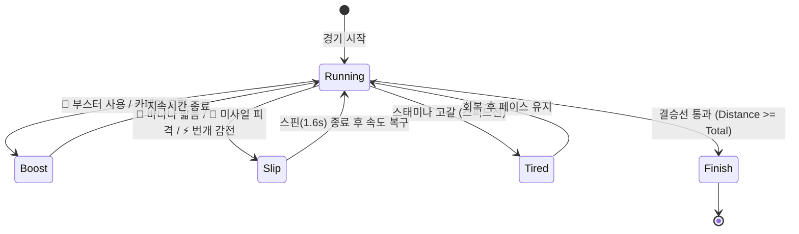

# 01. 전체 아키텍처 (Architecture)

## 1. 개요 및 설계 철학
오피스 더비(Office Derby)는 **100% 무중단 클라이언트 사이드(Zero Backend)**로 구동되는 사내 커피내기 경마 게임입니다.
순수 비즈니스 로직(물리, 아이템, 벌칙 계산, AI 전략)과 렌더링/UI 계층을 엄격히 분리하여 **100% 테스터블(Testable)**하게 설계되었습니다.

```
[ UI Layer (index.html, css/ ) ]
           ▲
           │ User Input / DOM Events / Keyboard Shortcuts / URL Share
           ▼
[ Application Controller (app.js) ]
  ├── PresetManager (presetManager.js) ──► localStorage (Team Presets)
  ├── StatsManager (statsManager.js)   ──► localStorage (Hall of Fame / Coffee Ledger)
  ├── PenaltyCalculator (penalty.js)   ──► Individual Orders & Post-Race MVP Badges
  ├── ReceiptExporter (receiptExporter.js) ──► High-DPI Thermal Receipt PNG
  └── SoundEngine (sound.js - Web Audio Synth + Procedural Derby BGM)
           ▲
           │ Event Callbacks & State Sync
           ▼
[ Core Simulation Engine (raceEngine.js - Fixed Timestep 1/60s) ]
  ├── SeededPRNG (rng.js - Mulberry32 Deterministic Engine)
  ├── ItemManager (itemManager.js - 8 Office & Derby Items)
  ├── OnDeviceAIEngine (aiEngine.js - Gemini Nano + Semantic Fallback)
  └── CanvasRenderer (canvasRenderer.js - 60FPS 3-Camera Director + Weather FX)
```

---

## 2. 모듈별 역할 및 책임 (Separation of Concerns)

### 1) Core Logic Modules (순수 로직, 무의존성, 완전 테스트 가능)
- **`js/rng.js`**: Mulberry32 기반 결정론적 시드 난수 생성기(`createRng`), 영숫자 시드 코드 변환(`seedToCode`, `codeToSeed`), 서브시드 파생(`deriveSeed`).
- **`js/penalty.js`**: 벌칙 룰(`last1`, `last2`, `winnerSafe`, `randomTarget`)에 따른 결제자 산정, 참가자별 개별 음료 영수증(`calculateDetailedOrder`), 경기 하이라이트 MVP 뱃지 5종 산출(`computeRaceMVPs`).
- **`js/itemManager.js`**: 아이템 상자 체크포인트 생성, 확률 기반 8종 아이템(`booster`, `banana`, `shield`, `lightning`, `missile`, `magnet`, `espresso`, `approval`) 획득 및 발동, 다중 레인 추격자 바나나 매설, 미사일/결재서류 궤적 계산, 장애물 충돌 및 쉴드 방어.
- **`js/presetManager.js`**: 사내 팀원 프리셋 목록 직렬화, localStorage CRUD, 참가자 데이터 객체 팩토리(희망 음료 `drinkId` 포함).
- **`js/statsManager.js`**: 사내 명예의 전당(누적 경기 수, 총 커피 잔수, 누적 결제 금액, 최다 결제 호구왕/무임승차 칼퇴왕 랭킹, 최근 20경기 히스토리) 집계 및 localStorage 영속화.
- **`js/aiEngine.js`**: Chrome `window.ai` (Gemini Nano) 세션 연결 및 브라우저 자체 오프라인 생성기, 5대 AI 성향별 프롬프트/의사결정 루프, 기상/스퍼트/꼴찌위기 실시간 중계 합성, 경기 후 1면 기사 생성.
- **`js/raceEngine.js`**: 고정 타임스텝(`FIXED_STEP = 1/60`) 기반 결정론적 물리 시뮬레이션, 공정 추첨 모드(`fair`) vs 능력치 전략 모드(`stats`), 기상 환경 4종(`sunny`, `rain`, `wind`, `night`) 물리 보정, 텔레메트리(추월/아이템/피격/방어) 추적, 포토피니시 판독.
- **`js/utils.js`**: XSS 방지를 위한 `escapeHtml` 및 DOM/포맷팅 유틸리티.

### 2) Presentation & Audio Layer (브라우저 종속 계층)
- **`js/canvasRenderer.js`**: HTML5 Canvas 2D 기반 60FPS 렌더러. 3종 카메라 디렉터(`lead` 선두 캠, `tail` 꼴찌 밀착 캠, `pack` 전체 캠), 기상 이펙트(빗줄기/강풍선/야간 스포트라이트), 트랙 전광판, 말 하단 미니 스태미나 바, 보유 아이템 말풍선, 부스터 잔상, 번개 낙뢰 연출.
- **`js/receiptExporter.js`**: 감열지 영수증(Thermal Receipt) 스타일의 고해상도(2x DPI) PNG 이미지 합성 및 원클릭 다운로드.
- **`js/sound.js`**: Web Audio API 오실레이터 기반 신디사이저. 절차적 경마 배경음악(William Tell Overture 모티프 아르페지오 & 라스트 스퍼트 변속 루프), 에스프레소/결재서류/포토피니시 효과음 합성.
- **`js/commentator.js`**: 실시간 해설 자막 UI 큐 관리 및 하이라이트 스타일링.
- **`js/app.js`**: 전체 라이프사이클 조율, 키보드 단축키(`Space`, `C`, `1/2/3`, `S`, `M`), URL 쿼리 파라미터 대진표/시드 공유, 명예의 전당 모달, 클립보드 복사.

---

## 3. 상태 머신 (Horse State Machine)

각 말은 매 프레임 아래의 상태 중 하나를 유지하며 물리 연산을 수행합니다:


